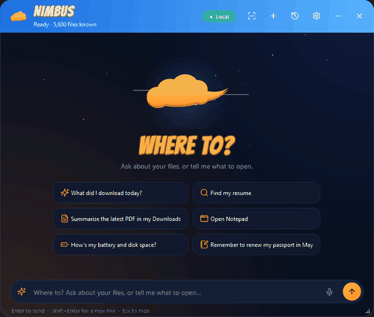
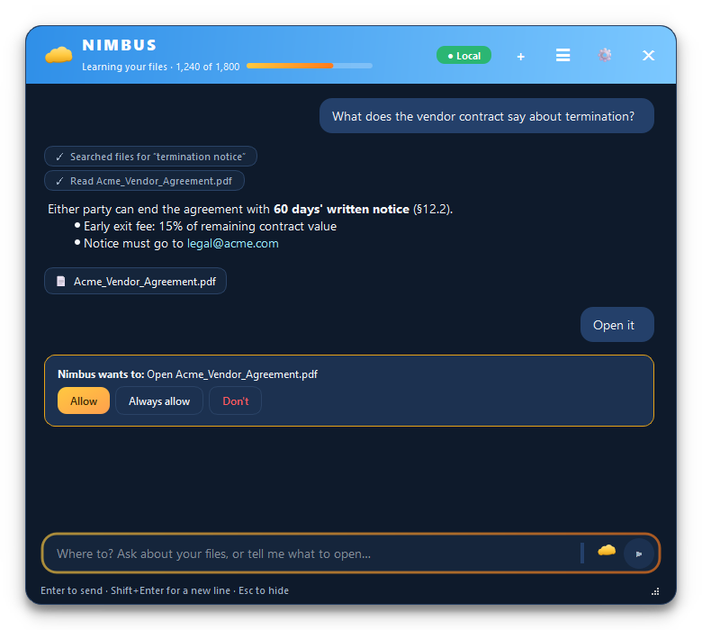
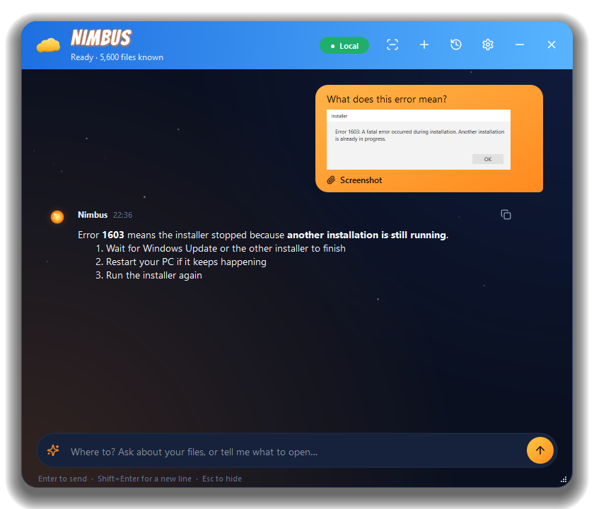
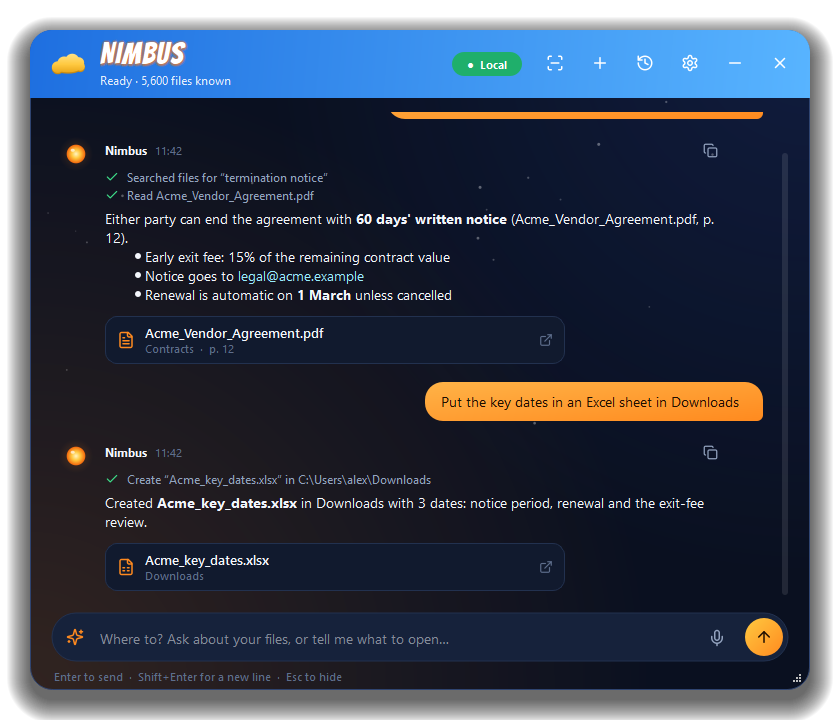
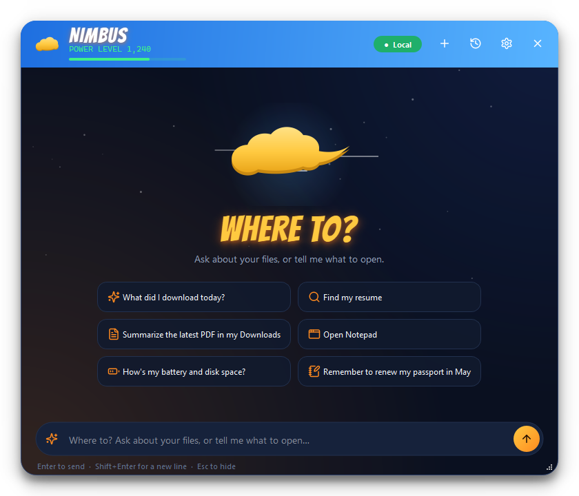
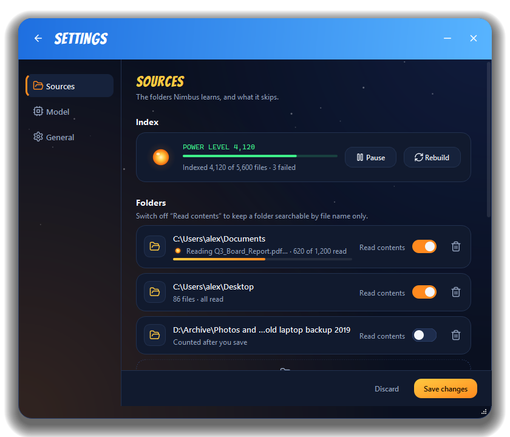
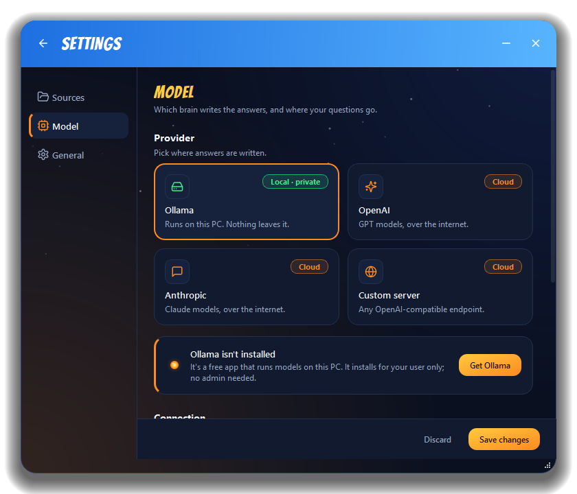
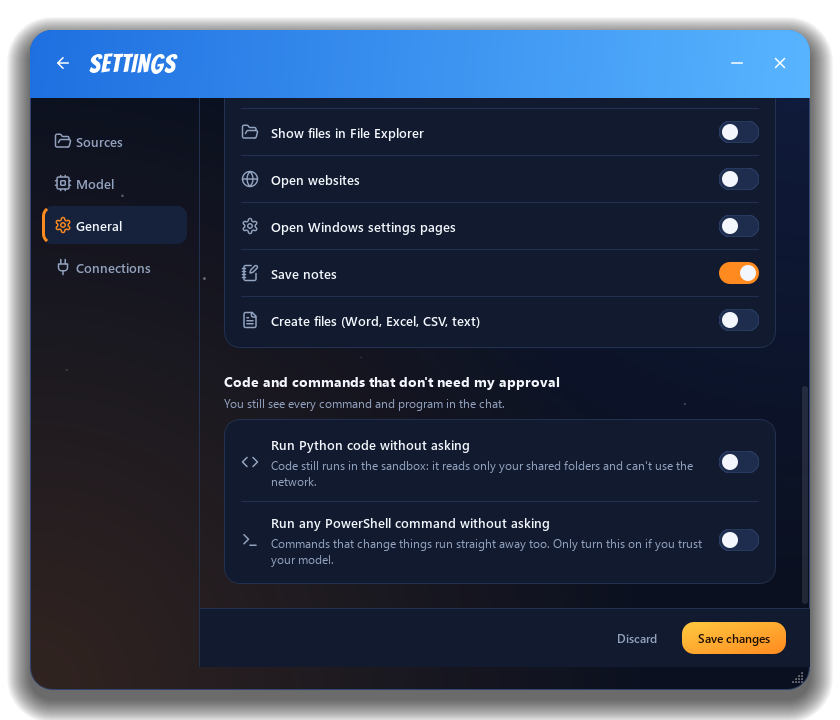
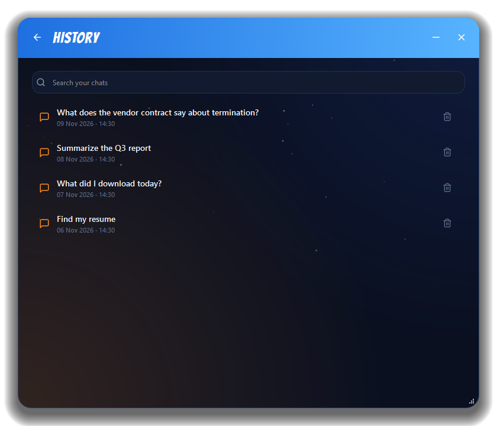
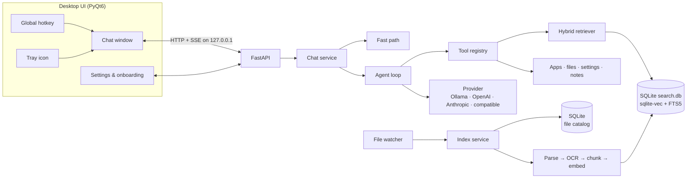

<p align="center">
  
</p>

<h1 align="center">Nimbus</h1>

<p align="center">
  <b>A private desktop assistant for your files and apps, summoned from anywhere with one hotkey.</b><br>
  Ask questions about your documents, find any file in milliseconds, and open apps, files and settings by just asking.<br>
  Runs fully on your PC by default. No admin rights needed.
</p>

<p align="center">
  
  
  
  
</p>

<p align="center">
  
  <br>
  <sub>Ask about a contract, get an answer that cites the page, then turn it into an Excel sheet. (Demo data.)</sub>
</p>

## What it does

Press **Ctrl+Space** in any app and Nimbus glides up, ready for a request:

| You type | Nimbus |
|---|---|
| *"What does the vendor contract say about termination?"* | Searches your documents, reads the right one, and answers with the source file linked |
| *"What did I download today?"* | Lists today's downloads and can summarize them |
| *"Summarize the Q3 report"* | Summarizes documents of any length (map-reduce for long ones) |
| *"find invoice_INV-2231.pdf"* | Answers instantly from the file catalog, with no AI call at all |
| *"open spotify"* | Launches the app straight away (Start Menu, registry and Store apps are all discovered) |
| *"Open the Wi-Fi settings"* · *"How's my battery?"* | Opens Windows Settings pages and reports system status |
| *"Remember that the project deadline is the 14th"* | Saves a note it can search later |
| *"Make an Excel sheet of these expenses in Downloads"* · *"Write the meeting notes as a Word doc"* | Creates real .xlsx, .docx, .csv, .txt or .md files in the folder you name, after you approve |
| Right-click a file in Explorer, *Ask Nimbus about this* | Opens with the file attached and one-click questions ready |
| Copy some text, then summon Nimbus | Offers *Use what I copied*, so you can ask about text from any app |
| Click the scan button and drag over part of the screen | Reads it with Windows OCR and answers about it ("what does this error mean?") |
| Click the microphone (or press Ctrl+M) and speak | Transcribes it on your PC with Whisper and puts the words in the message box, ready to send |

Anything that **launches or writes** shows an approval card first: *Allow*, *Always allow*, or *Don't*.

## Highlights

- **Bring your own model.** Ollama (local), OpenAI, Anthropic (Claude), or any OpenAI-compatible server, switchable in Settings without a restart. For local models, Settings suggests the one that fits your PC, from its RAM and graphics card. API keys are stored in **Windows Credential Manager**, never in plain-text files.
- **Private by default.** Search, embeddings, OCR, chat history and notes never leave the machine. A **Local / Cloud** badge shows where answers are generated, and switching to a cloud model asks first.
- **Usable from the first second.** A two-tier index makes every file findable *by name* within seconds, while contents are indexed in the background, newest files first. Questions are never blocked by indexing.
- **Answers you can check.** PDF answers cite the page, and clicking the source opens the PDF right at that page (Edge, Chrome, Acrobat and SumatraPDF are supported).
- **Search inside images.** Screenshots, scans and photos of whiteboards are read with the OCR engine built into Windows, so their text is searchable too.
- **Works with slow local models.** A heartbeat keeps the connection alive while a local model thinks, a live indicator shows it's working, and a stop button ends a reply at any time. Switching chats never interrupts a running answer.
- **You decide what it learns.** Pick folders, mark any folder "names only", choose file types, set a size limit and exclude patterns, all from the Settings window.
- **Built for locked-down work laptops.** No admin rights, no services, no keyboard hooks: the hotkey uses the Windows `RegisterHotKey` API, data lives in `%APPDATA%`, and the API server binds to `127.0.0.1` only and requires a per-run secret.
- **Small and fast.** No PyTorch and no separate database server. The whole search index is one SQLite file, and the standalone release is about 120 MB zipped.
- **A UI with personality.** Original artwork inspired by a flying golden cloud: a sky header with speed lines, an energy orb that pulses while Nimbus thinks, a scouter-style power level for indexing progress, and comic-style headlines. Settings and history open inside the same window, with a back arrow to return to the chat.

## A look around

| | |
|:---:|:---:|
|  |  |
| **Answers with sources.** The card opens the PDF at the cited page; actions wait for approval. | **Ask about the screen.** Box any part of it; Windows OCR reads it. |
|  |  |
| **Make files.** Word, Excel, CSV, text and Markdown, in the folder you name. | **Start anywhere.** Suggestions, plus an offer to use what you just copied. |
|  |  |
| **Choose what it learns.** Folders, file types and live indexing progress. | **Bring your own model.** Local Ollama or a cloud provider. |
|  |  |
| **Fits into Windows.** Hotkey, start at sign-in, and an Explorer right-click entry. | **Every chat saved locally.** Search and reopen past conversations. |

## Engineering notes

**Query-aware hybrid retrieval.** Vector search (meaning) and BM25 keyword search (exact tokens)
are merged with **weighted reciprocal rank fusion**, and the weight depends on the question. Codes
(`INV-2231`, `E119`), acronyms, quoted phrases and names get full keyword weight; a plain
question ("how much did we pay for the desks") is left to vector search, because there an
OR-of-words keyword ranking is mostly noise ("pay" appears in every invoice).

Measured on a labelled benchmark (`python scripts/eval_retrieval.py`): a small 16-file corpus,
and 100 look-alike documents (20 invoices, 15 project meetings, 12 trips...) generated
reproducibly by [`scripts/build_eval_corpus.py`](scripts/build_eval_corpus.py). Each set has
direct questions and paraphrases that avoid the document's own words. Top-1 accuracy (recall@1):

| Strategy | Small, direct | Small, paraphrased | 100 docs, direct | 100 docs, paraphrased | ms / query |
|---|---|---|---|---|---|
| Vector only | 0.96 | 1.00 | 0.82 | 0.80 | 20 |
| Hybrid, equal weights | 1.00 | 0.88 | 1.00 | 0.45 | 21 |
| **Hybrid, query-aware** | **1.00** | **1.00** | **1.00** | **0.78** | 21 |
| Query-aware + cross-encoder rerank | 1.00 | 1.00 | 1.00 | 0.74 | 270 |

The 100-document set is what exposed the problem: with equal weights, keyword noise dragged
paraphrased questions down to 0.45. Only query-aware fusion is perfect on direct questions
while staying close to the best on paraphrases. A cross-encoder reranker (Jina's 8K-context
model, ONNX) is built in but **off by default**: on top of query-aware fusion it added no
accuracy and cost about a quarter of a second per question (`rerank_enabled` turns it on).

The embedding model was picked the same way, query-aware hybrid, 100 docs, paraphrased:

| Embedding model | Download | Top-1 | MRR | Other three sets | Indexing |
|---|---|---|---|---|---|
| bge-small-en-v1.5 (previous) | 0.07 GB | 0.73 | 0.80 | all 1.00 | 33 files/s |
| **gte-base** | 0.44 GB | **0.78** | **0.84** | **all 1.00** | 19 files/s |
| bge-large-en-v1.5 | 1.2 GB | 0.76 | 0.83 | one drops to 0.96 | 6 files/s |
| mxbai-embed-large-v1 | 0.64 GB | 0.81 | 0.87 | one drops to 0.92 | 6 files/s |

Most remaining misses need world knowledge ("the dark chocolate chilli sauce" is *mole negro*).
Having the local model rewrite each question before searching was tested too, and it lowered
accuracy (0.78 to between 0.73 and 0.77, with small drops on direct questions) while adding a
model call to every search, so it isn't used.

**One SQLite file for search.** Chunk text, 768-dim embeddings ([sqlite-vec](https://github.com/asg017/sqlite-vec))
and an FTS5 full-text index share one database with WAL mode, so searches run while indexing
writes. Compared with the LanceDB store it replaced, at 20,000 chunks:

| | LanceDB | SQLite + sqlite-vec + FTS5 |
|---|---|---|
| Index 20k chunks | 45.2 s | **17.7 s** |
| Vector search | 45 ms | **21 ms** |
| Keyword search | 21 ms | **1.1 ms** |

**Tool-calling agent with a human in the loop.** One provider-neutral tool schema is translated
to each vendor's native function-calling format. The agent loop streams text and tool steps
over Server-Sent Events, pauses on action tools until the user approves, persists the paused
turn (so approval survives a restart), and falls back to plain retrieval-augmented answers for
local models without tool support. A deterministic fast path answers common commands with **zero
model calls**.

**Incremental, crash-safe indexing.** A SQLite file catalog tracks every file's size, modified
time and status. Rescans skip unchanged files without reading them, content hashes skip
re-embedding after a mere touch, and a schema/model version check triggers a clean rebuild
instead of mixing incompatible vectors.

**Lean document pipeline.** Embeddings run on ONNX (`fastembed`, `gte-base`, picked on the benchmark below over five other models). PDFs are
read from their text layer with pdfium, and scanned PDFs go through the OCR engine built into
Windows, which reads a page in well under 100 ms with nothing extra to download. Office and
Outlook files go through MarkItDown with only those converters installed.



The full design (process model, data flows, storage layout and security model) is in
[`docs/ARCHITECTURE.md`](docs/ARCHITECTURE.md).

## Getting started

### Run from source

Requires Windows 10/11 and Python 3.11+.

```powershell
git clone <repository-url> nimbus
cd nimbus
python -m venv nimbus-env
nimbus-env\Scripts\activate
pip install -r requirements.txt
python main.py
```

A setup wizard opens on first launch: pick the folders to learn, choose a model, and set your
hotkey. Indexing starts in the background, and Nimbus lives in the system tray from then on.

### Choosing a model

- **Fully local (recommended for work machines):** install [Ollama](https://ollama.com), run
  `ollama pull llama3.1:8b`, and pick *Ollama* in the wizard. Nothing leaves your PC.
- **Cloud:** pick OpenAI or Anthropic, paste an API key, and press *Test connection* to load the
  available models.
- **Other servers:** *Custom OpenAI-compatible server* works with DeepInfra, Groq, LM Studio,
  vLLM and others. Just enter the base URL.

### Build a standalone release

```powershell
pip install -r requirements-dev.txt
python scripts/build_release.py      # creates dist/Nimbus/Nimbus.exe and dist/Nimbus-<version>-win64.zip
```

## Privacy & security

- File contents only leave the machine if you choose a cloud model, and then only the excerpts
  needed to answer the current question.
- Nimbus never modifies, moves or deletes your files. Apart from its own notes, index and
  settings under `%APPDATA%\Nimbus`, it only writes new files you ask for, after you approve the
  exact path, and never over an existing file.
- File tools refuse any path outside the folders you shared (path traversal is resolved first).
- The local API only answers requests that carry a secret made fresh at every start (shared in
  memory between the window and the engine, never written to disk) and that are addressed to
  `127.0.0.1` or `localhost`. Other programs on the PC and DNS-rebinding web pages are refused.
- Voice input is transcribed on your PC by a local Whisper model (faster-whisper, about 150 MB,
  downloaded on first use). The audio never leaves the machine and is never saved; the microphone
  is only opened after you click it.
- Logs record paths, counts and timings, never file contents, prompts or API keys.

## Project structure

```
api/        FastAPI routes (chat streaming, indexing, settings, apps)
config/     Settings model, saved-settings store, data paths, 1.x migration
core/       Indexing pipeline, retrieval, agent loop, chat service, storage
llm/        Provider interface + Ollama / OpenAI / Anthropic backends, prompts
models/     Pydantic data contracts shared across layers
tools/      Tools the agent can call: files, apps, system actions, notes
ui/         Chat window, Settings, onboarding, tray, hotkey, theme
scripts/    Retrieval benchmark, CLI indexer, release build
tests/      1,500+ tests mirroring the source tree, fully offline
```

## Development

```powershell
pip install -r requirements-dev.txt
pytest -q                          # whole suite, no network or real model calls
ruff check .                       # lint and import order
python scripts/eval_retrieval.py   # retrieval benchmark
```

CI runs lint and the full test suite on Windows for every push. House style and conventions
are in [`CONTRIBUTING.md`](CONTRIBUTING.md).

## Limitations

- Windows only for now. The engine is OS-agnostic, but app discovery, the hotkey, autostart and
  OCR use Windows APIs.
- Scanned PDFs need a Windows display language with OCR support (English and most major
  languages have it). Without one, those files are still searchable by name.
- Small local models (under ~8B parameters) are noticeably weaker at choosing tools than
  cloud models; Nimbus falls back to plain retrieval answers when a model can't call tools.

## Roadmap

Asking about the clipboard or a screenshot, the Explorer right-click action, searchable
images and page-level PDF citations have shipped. What's next (reranking, browser history,
Outlook, voice, an MCP server and more) is in [`docs/ROADMAP.md`](docs/ROADMAP.md).

## About the name

In Dragon Ball, the Flying Nimbus is a cloud you call and it takes you wherever you need to go.
That's the idea here: call it from anywhere, and it gets you to the file, answer or app you
were after. The golden-cloud look is an original design inspired by it: no artwork, characters
or logos from the series are used.

## Credits

- Line icons: [Lucide](https://lucide.dev) (ISC licence, see `assets/icons/LICENSE.txt`).
- Display font: [Bangers](https://fonts.google.com/specimen/Bangers) by Vernon Adams (SIL Open
  Font Licence, see `assets/fonts/OFL.txt`).

## License

[MIT](LICENSE)
