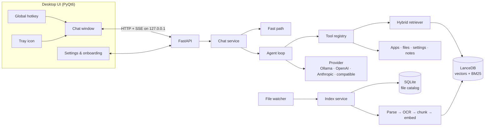

<p align="center">
  
</p>

<h1 align="center">Nimbus</h1>

<p align="center">
  <b>A private desktop assistant for your files and apps — summoned from anywhere with one hotkey.</b><br>
  Ask questions about your documents, find any file in milliseconds, and open apps, files and settings by just asking.<br>
  Runs fully on your PC by default. No admin rights needed.
</p>

<p align="center">
  
  
  
  
</p>

<p align="center">
  
</p>

---

## What it does

Press **Ctrl+Space** in any app and Nimbus glides up, ready for a request:

| You type | Nimbus |
|---|---|
| *"What does the vendor contract say about termination?"* | Searches your documents, reads the right one, and answers with the source file linked |
| *"What did I download today?"* | Lists today's downloads and can summarize them |
| *"Summarize the Q3 report"* | Summarizes documents of any length (map-reduce for long ones) |
| *"find invoice_INV-2231.pdf"* | Answers instantly from the file catalog — no AI call at all |
| *"open spotify"* | Launches the app straight away (Start Menu, registry and Store apps are all discovered) |
| *"Open the Wi-Fi settings"* · *"How's my battery?"* | Opens Windows Settings pages and reports system status |
| *"Remember that the project deadline is the 14th"* | Saves a note it can search later |

Anything that **launches or writes** shows an approval card first — *Allow*, *Always allow*, or *Don't*.

## Highlights

- **Bring your own model.** Ollama (local), OpenAI, Anthropic (Claude), or any OpenAI-compatible server — switchable in Settings without a restart. API keys are stored in **Windows Credential Manager**, never in plain-text files.
- **Private by default.** Search, embeddings, chat history and notes never leave the machine. A **Local / Cloud** badge shows where answers are generated, and switching to a cloud model asks first.
- **Usable from the first second.** A two-tier index makes every file findable *by name* within seconds, while contents are indexed in the background — newest files first. Questions are never blocked by indexing.
- **You decide what it learns.** Pick folders, mark any folder "names only", choose file types, set a size limit and exclude patterns — all from the Settings window.
- **Built for locked-down work laptops.** No admin rights, no services, no keyboard hooks: the hotkey uses the Windows `RegisterHotKey` API, data lives in `%APPDATA%`, and the API server binds to `127.0.0.1` only.

<p align="center">
  
  &nbsp;
  
</p>

## Engineering notes

**Hybrid retrieval.** Every question runs vector search (meaning) and BM25 keyword search (exact
tokens like `INV-2231` or a surname) in parallel and merges them with **reciprocal rank fusion**.
On the labelled benchmark in [`tests/fixtures/eval_corpus`](tests/fixtures/eval_corpus)
(`python scripts/eval_retrieval.py`):

| Strategy | recall@1 | recall@5 | MRR | ms / query |
|---|---|---|---|---|
| Vector only | 0.92 | 1.00 | 0.95 | 12 |
| **Hybrid (vector + BM25, RRF)** | **0.96** | **1.00** | **0.98** | 20 |

**Tool-calling agent with a human in the loop.** One provider-neutral tool schema is translated
to each vendor's native function-calling format. The agent loop streams text and tool steps
over Server-Sent Events, pauses on action tools until the user approves, persists the paused
turn (so approval survives a restart), and falls back to plain retrieval-augmented answers for
local models without tool support. A deterministic fast path answers common commands with **zero
model calls**.

**Incremental, crash-safe indexing.** A SQLite file catalog tracks every file's size, modified
time and status. Rescans skip unchanged files without reading them, content hashes skip
re-embedding after a mere touch, and a schema/model version check triggers a clean rebuild
instead of mixing incompatible vectors. Scanned PDFs fall back to on-device OCR.

**No torch.** Embeddings run on ONNX (`fastembed`, `bge-small-en-v1.5`) and PDFs are read from
their text layer — keeping the install a fraction of the size of a PyTorch-based stack.



The full design — process model, data flows, storage layout and security model — is in
[`docs/ARCHITECTURE.md`](docs/ARCHITECTURE.md).

## Getting started

### Run from source

Requires Windows 10/11 and Python 3.11+.

```powershell
git clone <repository-url> nimbus
cd nimbus
python -m venv .venv
.venv\Scripts\activate
pip install -r requirements.txt
python main.py
```

A setup wizard opens on first launch: pick the folders to learn, choose a model, and set your
hotkey. Indexing starts in the background, and Nimbus lives in the system tray from then on.

### Choosing a model

- **Fully local (recommended for work machines):** install [Ollama](https://ollama.com), run
  `ollama pull llama3.1:8b`, and pick *Ollama* in the wizard. Nothing leaves your PC.
- **Cloud:** pick OpenAI or Anthropic, paste an API key, and press *Test connection* to load the
  available models.
- **Other servers:** *Custom OpenAI-compatible server* works with DeepInfra, Groq, LM Studio,
  vLLM and others — just enter the base URL.

### Build a standalone release

```powershell
pip install -r requirements-dev.txt
python scripts/build_release.py      # → dist/Nimbus/Nimbus.exe and dist/Nimbus-<version>-win64.zip
```

## Privacy & security

- File contents only leave the machine if you choose a cloud model — and then only the excerpts
  needed to answer the current question.
- Nimbus never modifies, moves or deletes your files. Its only writes are its own notes, index
  and settings under `%APPDATA%\Nimbus`.
- File tools refuse any path outside the folders you shared (path traversal is resolved first).
- Logs record paths, counts and timings — never file contents, prompts or API keys.

## Project structure

```
api/        FastAPI routes (chat streaming, indexing, settings, apps)
config/     Settings model, saved-settings store, data paths, 1.x migration
core/       Indexing pipeline, retrieval, agent loop, chat service, storage
llm/        Provider interface + Ollama / OpenAI / Anthropic backends, prompts
models/     Pydantic data contracts shared across layers
tools/      Tools the agent can call: files, apps, system actions, notes
ui/         Chat window, Settings, onboarding, tray, hotkey, theme
scripts/    Retrieval benchmark, CLI indexer, release build
tests/      1,100+ tests mirroring the source tree — fully offline
```

## Development

```powershell
pip install -r requirements-dev.txt
pytest -q                          # whole suite, no network or real model calls
ruff check .                       # lint and import order
python scripts/eval_retrieval.py   # retrieval benchmark
```

CI runs lint and the full test suite on Windows for every push. House style and conventions
are in [`CONTRIBUTING.md`](CONTRIBUTING.md).

## Limitations

- Windows only for now. The engine is OS-agnostic, but app discovery, the hotkey and autostart
  use Windows APIs.
- Small local models (under ~8B parameters) are noticeably weaker at choosing tools than
  cloud models; Nimbus falls back to plain retrieval answers when a model can't call tools.
- The standalone build is large (~330 MB zipped), mostly the vector database and OCR runtime.

## About the name

In Dragon Ball, the Flying Nimbus is a cloud you call and it takes you wherever you need to go.
That's the idea here: call it from anywhere, and it gets you to the file, answer or app you
were after. The golden-cloud look is an original design inspired by it.

## License

[MIT](LICENSE)
