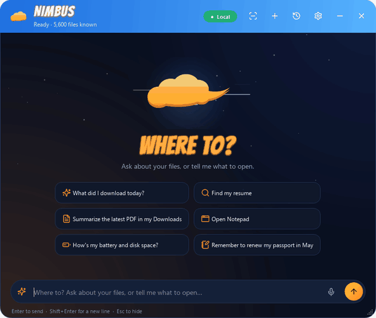
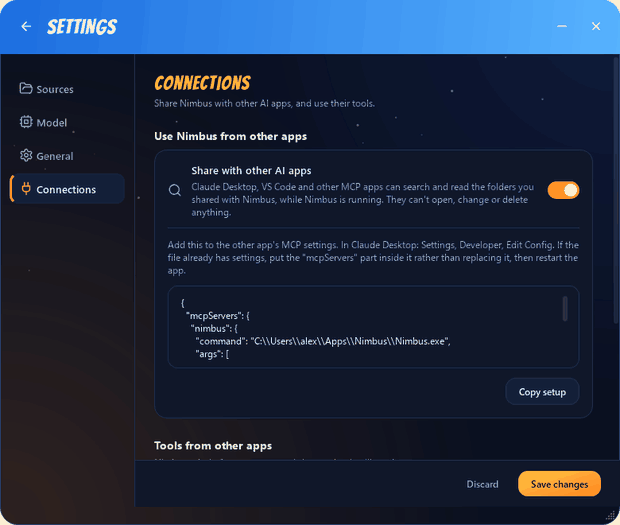
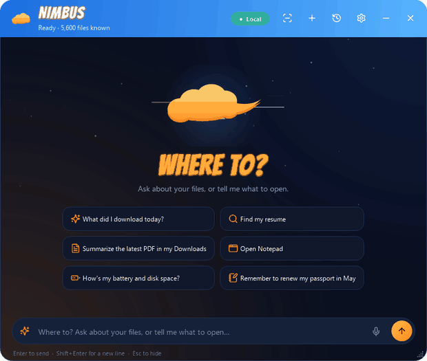
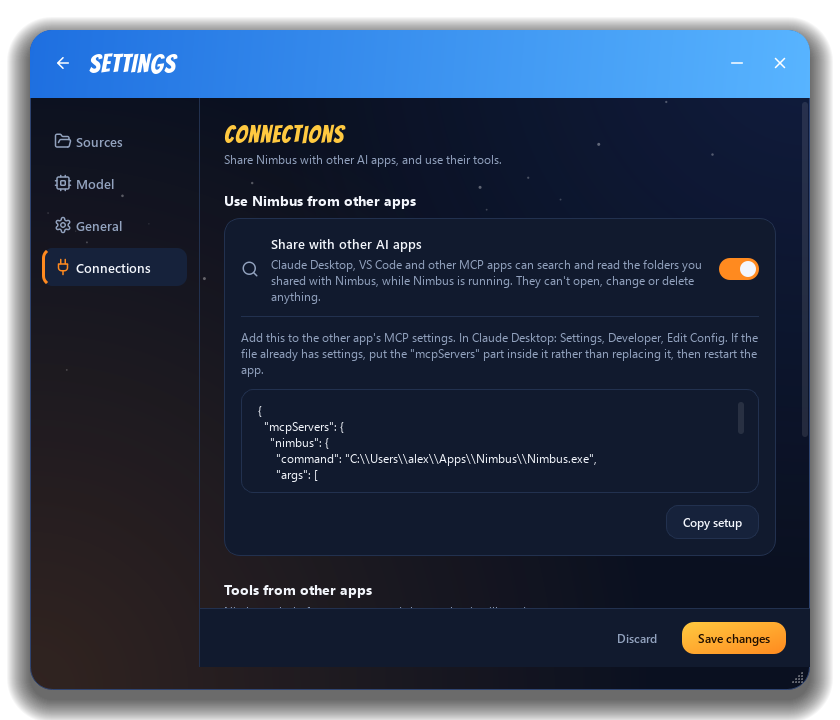
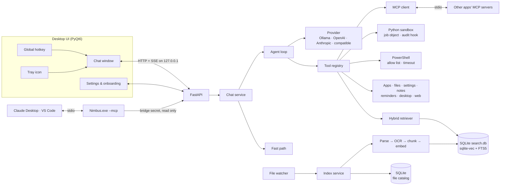

<p align="center">
  
</p>

<h1 align="center">Nimbus</h1>

<p align="center">
  <b>A private AI assistant that lives on your Windows PC: it knows your files, runs your computer, and works with other AI apps.</b><br>
  Summon it from anywhere with one hotkey. Ask about your documents, crunch a spreadsheet with sandboxed Python,<br>
  find out what's slowing your PC, tidy files with undo, and let Claude Desktop search your files over MCP.<br>
  Runs fully on your PC by default. No admin rights needed.
</p>

<p align="center">
  
  
  
  
  
  
</p>

<p align="center">
  
  <br>
  <sub><b>One request, six steps:</b> finds the spreadsheets, reads the board report, writes and runs Python (after you approve the code),<br>
  charts the result, explains the biggest miss with a page citation, and sets a reminder. All on your PC. (Demo data.)</sub>
</p>

<p align="center">
  <a href="#what-it-does">What it does</a> ·
  <a href="#see-it-in-action">See it in action</a> ·
  <a href="#safe-by-design">Safe by design</a> ·
  <a href="#engineering-notes">Engineering notes</a> ·
  <a href="#getting-started">Getting started</a>
</p>

## What it does

Press **Ctrl+Space** in any app and Nimbus glides up, ready for a request:

| | You type | Nimbus |
|---|---|---|
| **Your files** | *"What does the vendor contract say about termination?"* | Searches your documents, reads the right one, and answers with the source linked (PDFs open at the cited page) |
| | *"Summarize the Q3 report"* · *"What did I download today?"* | Summarizes documents of any length and lists recent files |
| | *"find invoice_INV-2231.pdf"* | Answers instantly from the file catalog, with no AI call at all |
| | *"Make an Excel sheet of these expenses in Downloads"* | Creates real .xlsx, .docx, .csv, .txt or .md files in the folder you name |
| | *"Move the invoices into an Invoices folder"* · *"Undo that"* | Moves or renames files inside your shared folders, and puts them back on request |
| **Data and code** | *"Total the Q3 sales by region and chart it"* | Writes a short Python program, shows it to you, and runs it in a locked-down sandbox |
| **Your PC** | *"Why is my PC slow?"* · *"What's my IP address?"* | Measures what's using the CPU and memory, or runs a read-only PowerShell command and explains it |
| | *"open spotify"* · *"Open the Wi-Fi settings"* | Launches apps and Windows Settings pages straight away |
| | *"Pause the music"* · *"Volume to 30"* · *"Switch to Excel"* | Controls media, volume and open windows |
| **Your day** | *"Remind me to call Sam at 5 pm"* | Shows a Windows notification when it's time, even with the window closed |
| | *"Summarize https://example.com/article"* | Reads the page and answers about it |
| | *"Remember that the deadline is the 14th"* · *"Copy that to my clipboard"* | Keeps searchable notes and puts text on the clipboard |
| **Anywhere** | Right-click a file in Explorer, *Ask Nimbus about this* | Opens with the file attached and one-click questions ready |
| | Copy text, or box part of the screen | Answers about what you copied, or reads the screen with Windows OCR |
| | Click the microphone (or press Ctrl+M) | Transcribes your voice on your PC with Whisper |
| **Other AI apps** | Ask Claude Desktop or VS Code about your files | Shares its search with other AI apps over MCP, and uses their tools too |

## See it in action

| | |
|:---:|:---:|
|  |  |
| **Data work in a sandbox.** The card shows the exact program before it runs. Output, chart and table follow. | **Ask about your PC.** Read-only checks just run. Anything that changes something asks first. |
|  |  |
| **Works with other AI apps (MCP).** Plug in any MCP server; every call shows its arguments first. | **Tidy files, with undo.** One approved change at a time, never overwriting, always reversible. |
|  |  |
| **Everyday helpers.** Reminders, web pages, music, windows and the clipboard. | **You set the rules.** Choose what runs without asking. Code and commands are a separate opt-in. |

<sub>All recordings use made-up demo data on the real Nimbus interface.</sub>

## Safe by design

An assistant that can run code and commands needs firm limits. Nimbus decides per action:

| When Nimbus wants to... | What happens |
|---|---|
| Search, find or read your files | Runs straight away, only inside the folders you shared (paths are resolved first, so `..` tricks fail) |
| Run a read-only command (`ipconfig`, `Get-Volume`, `winget list`...) | Runs straight away. Each statement is checked against an allow list, the program must be Windows' own, and redirection, script blocks or file arguments need approval |
| Look up or ping a name (`ping`, `Resolve-DnsName`...) | Runs straight away for a name you typed or an IP address; any other name asks first, since a lookup can carry data out |
| Run any other command | Shows the exact command on a card, every time. Administrator rights are refused outright |
| Run Python | Shows the whole program first. It runs in a separate process with time and memory limits, can read only your shared folders (links are followed before checking), writes only to its own folder, opens databases only there, and can't start programs or use the network |
| Move or rename a file | Asks for each change, never overwrites (a taken name gets "(2)"), and logs it so "undo that" works, even after a restart |
| Read a web page it found by itself | Asks first. Links you type are read straight away; private and local network addresses are always refused |
| Use another app's MCP tool | Shows the tool and its exact arguments on a card |
| Let another AI app search through it | Only when you turn sharing on: read-only tools, behind a separate secret that opens nothing else |

Code and commands show in the chat as they run: a few lines at first, the rest a click away, then
what they printed. If you trust your model, **Settings, General** lets code and commands run
without the card (off by default; the sandbox and the admin refusal still apply).

## Highlights

- **Bring your own model.** Ollama (local), OpenAI, Anthropic (Claude), or any OpenAI-compatible server, switchable in Settings without a restart. For local models, Settings suggests the one that fits your PC, from its RAM and graphics card. API keys are stored in **Windows Credential Manager**, never in plain-text files.
- **Private by default.** Search, embeddings, OCR, voice, chat history and notes never leave the machine. A **Local / Cloud** badge shows where answers are generated, and switching to a cloud model asks first.
- **Works with other AI apps.** Nimbus is an MCP server (Claude Desktop, VS Code and Cursor can search your shared folders through it) and an MCP client (add any MCP server in Settings and its tools join the chat).
- **Usable from the first second.** A two-tier index makes every file findable *by name* within seconds, while contents are indexed in the background, newest files first. Questions are never blocked by indexing.
- **Answers you can check.** PDF answers cite the page, and clicking the source opens the PDF right at that page (Edge, Chrome, Acrobat and SumatraPDF are supported).
- **Search inside images.** Screenshots, scans and photos of whiteboards are read with the OCR engine built into Windows, so their text is searchable too.
- **Works with slow local models.** A heartbeat keeps the connection alive while a local model thinks, a live indicator shows it's working, and a stop button ends a reply at any time. Switching chats never interrupts a running answer.
- **Built for locked-down work laptops.** No admin rights, no services, no keyboard hooks: the hotkey uses the Windows `RegisterHotKey` API, data lives in `%APPDATA%`, and the API server binds to `127.0.0.1` only and requires a per-run secret.
- **Small and fast.** No PyTorch and no separate database server. The whole search index is one SQLite file, and the standalone release is about 200 MB zipped, Python and its data libraries included.
- **A UI with personality.** Original artwork inspired by a flying golden cloud: a sky header with speed lines, an energy orb that pulses while Nimbus thinks, a scouter-style power level for indexing progress, and comic-style headlines.

## A look around

| | |
|:---:|:---:|
|  |  |
| **Answers with sources.** The card opens the PDF at the cited page; actions wait for approval. | **Ask about the screen.** Box any part of it; Windows OCR reads it. |
|  |  |
| **Connect other AI apps.** One switch, and setup text to paste into Claude Desktop. | **Start anywhere.** Suggestions, plus an offer to use what you just copied. |
|  |  |
| **Choose what it learns.** Folders, file types and live indexing progress. | **Bring your own model.** Local Ollama or a cloud provider. |
|  |  |
| **Make files.** Word, Excel, CSV, text and Markdown, in the folder you name. | **Every chat saved locally.** Search and reopen past conversations. |

## Engineering notes

**Query-aware hybrid retrieval.** Vector search (meaning) and BM25 keyword search (exact tokens)
are merged with **weighted reciprocal rank fusion**, and the weight depends on the question. Codes
(`INV-2231`, `E119`), acronyms, quoted phrases and names get full keyword weight; a plain
question ("how much did we pay for the desks") is left to vector search, because there an
OR-of-words keyword ranking is mostly noise ("pay" appears in every invoice).

Measured on a labelled benchmark (`python scripts/eval_retrieval.py`): a small 16-file corpus,
and 100 look-alike documents (20 invoices, 15 project meetings, 12 trips...) generated
reproducibly by [`scripts/build_eval_corpus.py`](scripts/build_eval_corpus.py). Each set has
direct questions and paraphrases that avoid the document's own words. Top-1 accuracy (recall@1):

| Strategy | Small, direct | Small, paraphrased | 100 docs, direct | 100 docs, paraphrased | ms / query |
|---|---|---|---|---|---|
| Vector only | 0.96 | 1.00 | 0.82 | 0.80 | 20 |
| Hybrid, equal weights | 1.00 | 0.88 | 1.00 | 0.45 | 21 |
| **Hybrid, query-aware** | **1.00** | **1.00** | **1.00** | **0.79** | 21 |
| Query-aware + cross-encoder rerank | 1.00 | 1.00 | 1.00 | 0.74 | 270 |

The 100-document set is what exposed the problem: with equal weights, keyword noise dragged
paraphrased questions down to 0.45. Only query-aware fusion is perfect on direct questions
while staying close to the best on paraphrases. A cross-encoder reranker (Jina's 8K-context
model, ONNX) is built in but **off by default**: on top of query-aware fusion it added no
accuracy and cost about a quarter of a second per question (`rerank_enabled` turns it on).

The embedding model was picked the same way, query-aware hybrid, 100 docs, paraphrased:

| Embedding model | Download | Top-1 | MRR | Other three sets | Indexing |
|---|---|---|---|---|---|
| bge-small-en-v1.5 (previous) | 0.07 GB | 0.73 | 0.80 | all 1.00 | 33 files/s |
| **gte-base** | 0.44 GB | **0.79** | **0.85** | **all 1.00** | 19 files/s |
| bge-large-en-v1.5 | 1.2 GB | 0.76 | 0.83 | one drops to 0.96 | 6 files/s |
| mxbai-embed-large-v1 | 0.64 GB | 0.81 | 0.87 | one drops to 0.92 | 6 files/s |

Most remaining misses need world knowledge ("the dark chocolate chilli sauce" is *mole negro*).
Having the local model rewrite each question before searching was tested too, and it lowered
accuracy (0.78 to between 0.73 and 0.77, with small drops on direct questions) while adding a
model call to every search, so it isn't used.

**One SQLite file for search.** Chunk text, 768-dim embeddings ([sqlite-vec](https://github.com/asg017/sqlite-vec))
and an FTS5 full-text index share one database with WAL mode, so searches run while indexing
writes. Compared with the LanceDB store it replaced, at 20,000 chunks:

| | LanceDB | SQLite + sqlite-vec + FTS5 |
|---|---|---|
| Index 20k chunks | 45.2 s | **17.7 s** |
| Vector search | 45 ms | **21 ms** |
| Keyword search | 21 ms | **1.1 ms** |

**Tool-calling agent with a human in the loop.** One provider-neutral tool schema is translated
to each vendor's native function-calling format. The agent loop streams text and tool steps
over Server-Sent Events, pauses on action tools until the user approves, persists the paused
turn (so approval survives a restart), and falls back to plain retrieval-augmented answers for
local models without tool support. A deterministic fast path answers common commands with **zero
model calls**.

**A Python sandbox built from Windows primitives.** Approved code runs in its own process
(`python -I`, or the packaged app itself with `--run-code`), inside a **Windows job object** that
caps memory (set in Settings) and kills the run if Nimbus exits. Inside, a
[`sys.addaudithook`](https://docs.python.org/3/library/sys.html#sys.addaudithook) guard checks
every file open, directory listing, process start, socket and native call: reads only in the
shared folders, writes only in the run's folder, no `subprocess`, no network, no `ctypes`.
numpy, pandas, openpyxl and matplotlib are imported *before* the guard goes up, so they work
while user code can't load anything native. Escape attempts (`WinExec` through `ctypes`,
`_winapi.CreateProcess`, `os.startfile`, a module reload) are covered by tests. numpy's math
library is limited to four threads, because on a 28-thread CPU it otherwise reserves more
memory than a small limit allows before any code runs.

**Commands with a two-tier policy.** PowerShell commands are split into statements (after
setting single-quoted text aside), and each must be a read-only cmdlet or a native tool with
read-only arguments (`netsh ... show`, `winget list`, `powercfg /requests`). Pipes may only
feed formatters; redirection, `&`, subexpressions and script blocks make a command need approval.
Elevation (`-Verb RunAs`, `runas`, `sudo`) is refused without even asking. Output is trimmed to
its head and tail, and a timeout kills the whole process tree.

**MCP in both directions.** As a **server**, `Nimbus.exe --mcp` speaks MCP over stdio and
forwards each call to the already-running engine, so other apps reuse the same index and loaded
model. The bridge gets its own secret, written to the user's profile only while sharing is on,
and it opens nothing but the read-only tool routes (search, find, read, recent files, file
info); the app's own secret doesn't open those routes either, and both were checked against
path tricks like `/tools%2F` and `//tools`. As a **client**, every
configured server is held open on one background event loop; its tools are registered in the
chat's tool registry under the server's name as they connect, with each call approved on a card
that shows the exact arguments.

**Incremental, crash-safe indexing.** A SQLite file catalog tracks every file's size, modified
time and status. Rescans skip unchanged files without reading them, content hashes skip
re-embedding after a mere touch, and a schema/model version check triggers a clean rebuild
instead of mixing incompatible vectors.

**Lean document pipeline.** Embeddings run on ONNX (`fastembed`, `gte-base`, picked on the benchmark below over five other models). PDFs are
read from their text layer with pdfium, and scanned PDFs go through the OCR engine built into
Windows, which reads a page in well under 100 ms with nothing extra to download. Office and
Outlook files go through MarkItDown with only those converters installed.



The full design (process model, data flows, storage layout and security model) is in
[`docs/ARCHITECTURE.md`](docs/ARCHITECTURE.md).

## Getting started

### Run from source

Requires Windows 10/11 and Python 3.11+.

```powershell
git clone <repository-url> nimbus
cd nimbus
python -m venv nimbus-env
nimbus-env\Scripts\activate
pip install -r requirements.txt
python main.py
```

A setup wizard opens on first launch: pick the folders to learn, choose a model, and set your
hotkey. Indexing starts in the background, and Nimbus lives in the system tray from then on.

### Choosing a model

- **Fully local (recommended for work machines):** install [Ollama](https://ollama.com), run
  `ollama pull llama3.1:8b`, and pick *Ollama* in the wizard. Nothing leaves your PC.
- **Cloud:** pick OpenAI or Anthropic, paste an API key, and press *Test connection* to load the
  available models.
- **Other servers:** *Custom OpenAI-compatible server* works with DeepInfra, Groq, LM Studio,
  vLLM and others. Just enter the base URL.

### Connect other AI apps (MCP)

- **Use Nimbus from Claude Desktop, VS Code or another MCP app:** in Settings, Connections, turn
  on *Share with other AI apps*, save, and click *Copy setup*. Add it to the other app's MCP
  configuration (Claude Desktop: Settings, Developer, Edit Config; if the file already has
  settings, put the `mcpServers` part inside it instead of replacing the file) and restart that
  app. It can then search, find and read your shared files while Nimbus is running. It can't
  change anything.
- **Use another app's tools from Nimbus:** in the same section, add a name and the command its
  MCP server documents, for example `uvx mcp-server-time` or
  `npx -y @modelcontextprotocol/server-memory`. The first start downloads the server, so it can
  take a minute; if it shows *Couldn't start*, save again to retry. Once it shows *Connected*,
  its tools appear in chat, named after the server, and ask before every use. A server that
  needs an access token can be given one in `settings.json` under `env`.

### Build a standalone release

```powershell
pip install -r requirements-dev.txt
python scripts/build_release.py      # creates dist/Nimbus/Nimbus.exe and dist/Nimbus-<version>-win64.zip
```

## Privacy & security

- File contents only leave the machine if you choose a cloud model, and then only the excerpts
  needed to answer the current question.
- Nimbus never deletes or overwrites your files. It writes only new files you ask for, moves
  or renames files only inside your shared folders, and asks first each time (see
  [Safe by design](#safe-by-design) for code, commands, web pages and MCP).
- Python runs keep their code, output and charts in `Documents\Nimbus\Code runs`, so you can
  always see what ran.
- Web pages are fetched with Nimbus's own honest user agent; sites that refuse automated
  reading get a polite "open it in a browser" instead of a workaround.
- The local API only answers requests that carry a secret made fresh at every start (shared in
  memory between the window and the engine) and that are addressed to `127.0.0.1` or
  `localhost`. Other programs on the PC and DNS-rebinding web pages are refused. When you turn
  on sharing with other AI apps, a second secret that opens only the read-only search tools is
  kept in your profile folder for the MCP bridge to use, and removed when sharing is off.
- Voice input is transcribed on your PC by a local Whisper model (faster-whisper, about 150 MB,
  downloaded on first use). The audio never leaves the machine and is never saved; the microphone
  is only opened after you click it.
- Logs record paths, counts and timings, never file contents, prompts or API keys.

## Project structure

```
api/        FastAPI routes (chat streaming, indexing, settings, apps, reminders, MCP bridge)
config/     Settings model, saved-settings store, data paths, 1.x migration
core/       Indexing pipeline, retrieval, agent loop, chat service, storage
llm/        Provider interface + Ollama / OpenAI / Anthropic backends, prompts
models/     Pydantic data contracts shared across layers
tools/      Tools the agent can call: files, apps, commands, code, desktop, reminders, web, MCP
ui/         Chat window, Settings, onboarding, tray, hotkey, theme
scripts/    Retrieval benchmark, CLI indexer, release build
tests/      1,950+ tests mirroring the source tree, fully offline
```

## Development

```powershell
pip install -r requirements-dev.txt
pytest -q                          # whole suite, no network or real model calls
ruff check .                       # lint and import order
python scripts/eval_retrieval.py   # retrieval benchmark
```

CI runs lint and the full test suite on Windows for every push. House style and conventions
are in [`CONTRIBUTING.md`](CONTRIBUTING.md).

## Limitations

- Windows only for now. The engine is OS-agnostic, but app discovery, the hotkey, autostart and
  OCR use Windows APIs.
- Scanned PDFs need a Windows display language with OCR support (English and most major
  languages have it). Without one, those files are still searchable by name.
- Small local models (under ~8B parameters) are noticeably weaker at choosing tools than
  cloud models; Nimbus falls back to plain retrieval answers when a model can't call tools.

## Roadmap

Voice input, reranking, PC diagnostics, sandboxed Python, reminders, desktop control, web
reading, file tidying and MCP in both directions have shipped. What's next is in
[`docs/ROADMAP.md`](docs/ROADMAP.md).

## About the name

In Dragon Ball, the Flying Nimbus is a cloud you call and it takes you wherever you need to go.
That's the idea here: call it from anywhere, and it gets you to the file, answer or app you
were after. The golden-cloud look is an original design inspired by it: no artwork, characters
or logos from the series are used.

## Credits

- Line icons: [Lucide](https://lucide.dev) (ISC licence, see `assets/icons/LICENSE.txt`).
- Display font: [Bangers](https://fonts.google.com/specimen/Bangers) by Vernon Adams (SIL Open
  Font Licence, see `assets/fonts/OFL.txt`).

## License

[MIT](LICENSE)
